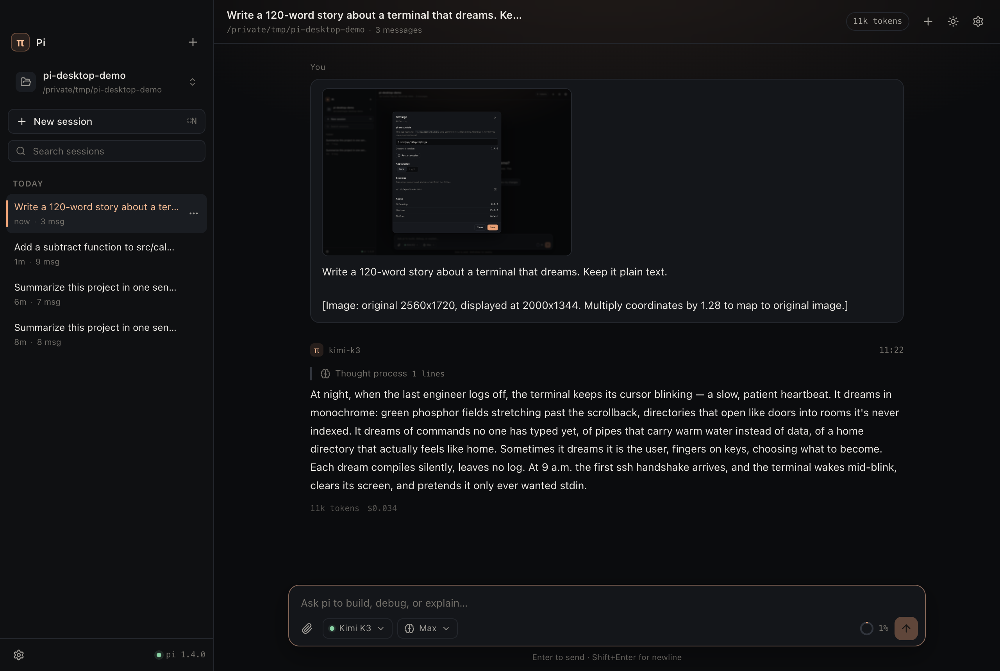
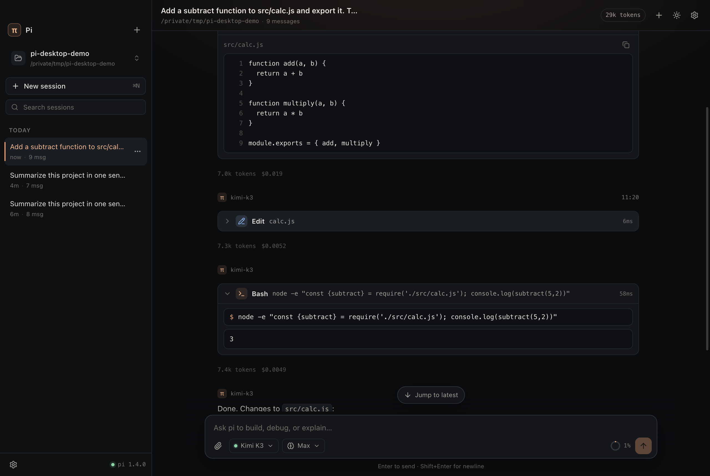
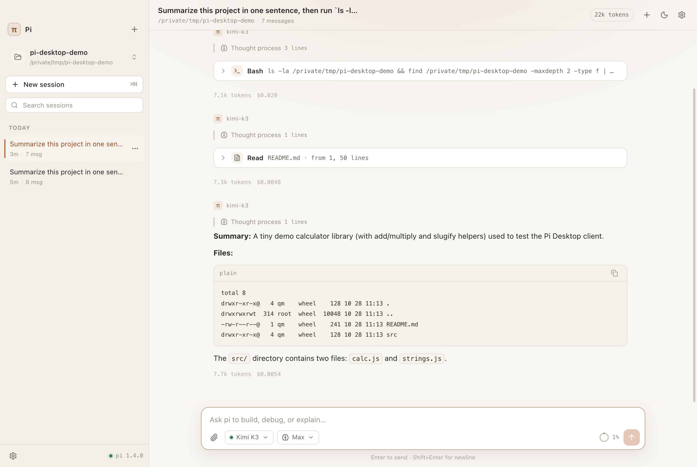
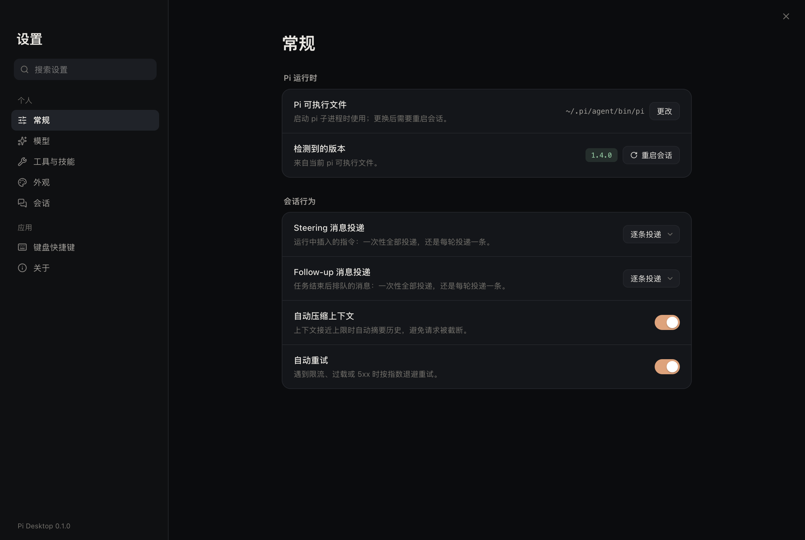
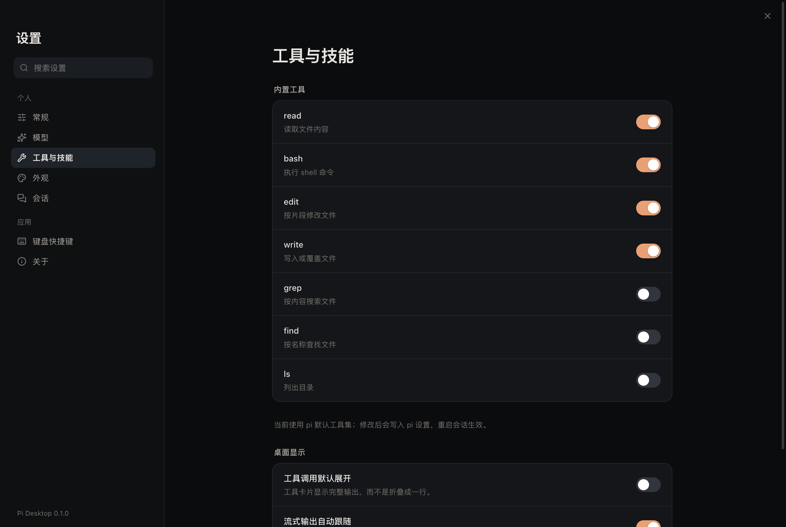

# Pi Desktop

一个把 [pi](https://pi.dev) 包装成桌面客户端的应用。参考 Codex Desktop / Claude Cowork 的形态：左边是项目与会话，中间是对话与工具执行，底部是模型、推理强度和上下文占用。

主进程用 `pi --mode rpc` 启动 pi 子进程，通过官方 JSONL 协议通信；渲染层不直接接触 Node，只消费结构化事件。

## 安装

前置条件：本机已安装并登录 [pi](https://pi.dev)（`curl -fsSL https://pi.dev/install.sh | sh` 或 `npm install -g --ignore-scripts @earendil-works/pi-coding-agent`）。应用只负责界面，模型与凭证都由 pi 管。

### 从 GitHub Release 安装（推荐）

1. 打开本仓库的 **Releases**，下载最新的 `Pi-Desktop-<版本>-arm64.dmg`（Apple Silicon）。
2. 双击挂载，把 **Pi Desktop** 拖到 **Applications**。
3. 首次打开如果提示“已损坏”或“无法验证开发者”，执行一次：

   ```bash
   xattr -dr com.apple.quarantine "/Applications/Pi Desktop.app"
   ```

   然后再打开即可。（当前构建是 ad-hoc 签名，没有 Developer ID 与公证，所以系统会拦一次。）

### 自己构建

```bash
npm install
npm run dmg          # 产物：release/Pi-Desktop-0.1.0-arm64.dmg
```

想升级版本号：改 `package.json` 的 `version`，打 tag `v0.1.0` 推到 GitHub，`.github/workflows/release.yml` 会自动构建 DMG 并挂到 Release 上。

> 分发说明：`.github/workflows/release.yml` 用 `macos-14` runner 构建。要发给别人用且不弹 Gatekeeper 警告，需要 Apple Developer ID 证书 + 公证（notarytool），把证书塞进仓库 Secrets 后把 `make-dmg.mjs` 里的 ad-hoc 签名换成 `codesign --sign "Developer ID Application: …"` 即可。



## 功能

- **项目 / 会话管理**：按工作区列出会话，支持搜索、重命名、在 Finder 中显示、删除；`⌘N` 新建，切换项目即切换工作目录。
- **流式对话**：文本、思考块、工具调用实时渲染；思考块在流式结束后自动折叠。
- **工具可视化**
  - `bash`：命令 + 实时输出
  - `read` / `write`：带行号的文件内容
  - `edit`：红绿 diff（只显示变更附近的上下文）
  - 其他工具：参数与结果 JSON
- **模型控制**：模型选择（按 provider 分组、可搜索）、推理强度（off → max）、上下文环形指示、手动 compact。
- **输入体验**：图片粘贴 / 拖拽 / 选择上传；`/` 唤起命令与 Skill；流式中可 Steer 或 Follow-up 排队；`Esc` 停止并把排队消息退回输入框。
- **原生集成**：macOS 隐藏式标题栏、应用菜单、快捷键、外链用默认浏览器打开。
- **两种主题**：暖色深色主题 + 米白浅色主题，设置页内带预览。
- **设置页**：整页双栏布局，左侧分组导航 + 搜索，右侧卡片式设置项。
  - **常规**：pi 路径、版本、重启会话、steering / follow-up 投递方式、自动压缩、自动重试
  - **模型**：新会话默认模型与默认推理强度、当前模型信息；`pi --list-models` 的可用模型列表（含上下文 / 思考 / 图片标记）；直接添加自定义服务商与模型（写 `~/.pi/agent/models.json`，支持 OpenAI 兼容、Anthropic、Google 协议以及 Ollama / LM Studio / vLLM / OpenRouter 预设），保存后自动重启会话让 pi 重新加载
  - **工具与技能**：按工具开关内置工具集、工具卡默认展开、流式自动跟随
  - **外观 / 会话 / 快捷键 / 关于**：主题、存储目录、工作区、快捷键表与版本信息
  - 运行时项（模式、压缩、重试）走 RPC 立即生效；默认值写入 pi 的 `settings.json`，对新会话生效
  - 设置页顶部保留 42px 可拖拽区，关闭按钮固定右上角，`Esc` 也可退出。
- **对话折叠（Turn）**：每一轮（提问 + 其后所有执行过程）是一条折叠单元，默认「保留结论 + 一行过程摘要」：`65 步 · bash×22 read×10 · 9 个文件 · 3m16s · 5.6M tokens · $0.034`。结论落地后过程自动收起（可在设置里关），流式中永不折叠，更早的轮次聚合成一行；`⌘.` 全收 / `⇧⌘.` 全展 / `⌘↑↓` 跳轮，折叠状态按会话持久化。
- **完整记录**：`⌘⇧O` 打开不折叠的全量 transcript，`⌘F` 搜索（命中计数 + 上下跳），Esc 关闭。
- **工具输出压缩**：连续同类调用自动合组（`read × 5`），单卡输出默认只显示 20 行 + 「还有 N 行 · 显示全部」，bash 优先显示尾部；复制仍是全文。
- **诊断与恢复**：侧栏底部状态点打开诊断抽屉（pi 路径 / 版本 / agent 目录 / 最后 60 行 stderr / `models.json` 错误 / 一键复制）；删除会话进 `.trash` 并在提示条里「撤销」；重启后回到上次的会话。
- **键盘可达**：菜单支持 ↑↓ / Home / End / Enter / Esc，关闭后焦点回到触发器，全局 `:focus-visible` 环。
- **流畅度**
  - 会话切换复用同一个 pi 进程（`switch_session`），不再重启子进程；最近看过的会话直接命中本地缓存。
  - 流式事件按动画帧合并，消息与工具卡做 memo + 增量渲染，长回复不卡顿。
  - 发送时立即插入乐观消息；滚动保持贴底，内容长高时自动跟随。

| Diff | Light |
| --- | --- |
|  |  |

| Settings | Tools |
| --- | --- |
|  |  |

## 架构

```
src/
  main/            Electron 主进程
    index.ts       窗口、菜单、IPC、pi 生命周期
    pi.ts          pi 子进程 + JSONL 协议（id 关联响应）
    sessions.ts    扫描 ~/.pi/agent/sessions/*.jsonl 生成会话列表
    pi-locate.ts   解析 pi 可执行文件（GUI 不继承 shell PATH）
    settings.ts    userData/settings.json（桌面端偏好）
    pi-settings.ts 读写 pi 的 ~/.pi/agent/settings.json
  preload/         contextBridge 暴露 window.pi
  renderer/        React 19 + Vite
    store.tsx      事件 → 消息 / 工具状态的 reducer
    components/    侧栏、顶栏、对话、工具卡、输入框、弹窗
  shared/          主进程与渲染层共享的类型与 API 契约
```

关键设计：

- 每条命令带 `id`，响应按 id 关联；`message_update` 的 delta 按 `contentIndex` 重建流式消息，`message_end` 用完整消息覆盖。
- 工具执行有独立的 `tool_execution_start/update/end` 事件，按 `toolCallId` 聚合，不用轮询。
- 会话列表只读 JSONL 文件头、`session_info` 和首条用户消息，并基于 mtime/size 缓存。
- 打开项目时用 `realpath` 规范化路径（macOS `/tmp` → `/private/tmp`），避免会话按工作区过滤时丢失。
- 设置页分两层：实时项用 RPC（`set_steering_mode`、`set_follow_up_mode`、`set_auto_compaction`、`set_auto_retry`）立即作用于当前进程；默认项（默认模型、推理强度、`defaultTools`）合并写入 `~/.pi/agent/settings.json`，不覆盖未知字段。
- 流式事件先在 `requestAnimationFrame` 里攒成一批再 dispatch；消息用 memo 隔离重渲染，markdown 重解析限制在约 55ms 一次。
- 会话消息在渲染层按 `sessionPath` 缓存；切换时先显示缓存，再用 `get_messages` 结果覆盖。
- 保持单换行（`remark-breaks`），模型逐行输出的内容不会被 markdown 折成一段。

## 开发

要求：Node.js 22+、macOS（其他平台未测试）、本机已安装并登录 pi。

```bash
npm install
npm run dev          # electron-vite dev（HMR）
npm run typecheck    # 主进程 + 渲染层类型检查
npm run build        # 生产构建到 out/
npm run smoke        # 启动一次，检查无 pageerror
npm run e2e          # 交互用例（用 scripts/mock-pi.mjs 假 pi，不烧 token）
```

`scripts/mock-pi.mjs` 是 `pi --mode rpc` 的替身，支持 `MOCK_SCENARIO=default|auth-error|catalog-huge|model-switch-fails`，
可以在没有凭证、没有真 pi 的环境（包括 CI）里跑通界面和失败路径。

pi 路径默认自动探测：

1. 设置里的路径
2. `PI_DESKTOP_PI_PATH`
3. `~/.pi/agent/bin/pi`
4. `/opt/homebrew/bin/pi`、`/usr/local/bin/pi`
5. 登录 shell 的 `command -v pi`

也可以在设置里手动指定。

## 打包

```bash
npm run pack         # 仅生成 .app
npm run dmg          # .app + DMG（内含 Applications 快捷方式，可直接拖拽安装）
# 产物：release/Pi Desktop-darwin-arm64/Pi Desktop.app
#       release/Pi-Desktop-0.1.0-arm64.dmg
```

打包脚本会做 ad-hoc 签名（`codesign --sign -`），保证 arm64 机器上能直接运行；但没有 Developer ID 与公证，其他人首次打开需要在「系统设置 → 隐私与安全性」放行，或执行 `xattr -dr com.apple.quarantine`。

## 快捷键

| 快捷键 | 动作 |
| --- | --- |
| `⌘N` | 新建会话 |
| `⌘O` | 打开项目 |
| `⌘B` | 收起/展开侧栏 |
| `⌘⇧L` | 切换主题 |
| `⌘,` | 设置 |
| `Enter` | 发送 |
| `Shift+Enter` | 换行 |
| `⌘.` / `⇧⌘.` | 收起 / 展开所有轮次 |
| `⌘⇧O` | 打开完整记录 |
| `⌘↑` / `⌘↓` | 跳到上/下一轮 |
| `Esc` | 停止（并把排队消息退回输入框） |

## 已知限制

- RPC 模式下 pi 的部分扩展 UI 能力不可用（`custom()`、自定义编辑器/主题组件等），本应用对 `select / confirm / input / editor` 做了原生实现，其余降级为提示。
- 会话列表为全量扫描后前端过滤，会话数量极大时需要改成分页/增量索引。
- 尚未实现：分支树（`/tree`）、fork/clone、导出 HTML、多窗口。
- 所有 pi 工具默认直接执行，没有二次确认；如果需要审批，应在 pi 侧用扩展实现。

## Roadmap

- 会话分支视图（`get_tree` / `fork`）
- 工具执行中的文件改动汇总面板
- 通知中心：长时间任务结束发系统通知
- 会话搜索走索引（SQLite）而不是全量扫描
- Windows / Linux 适配与签名分发
