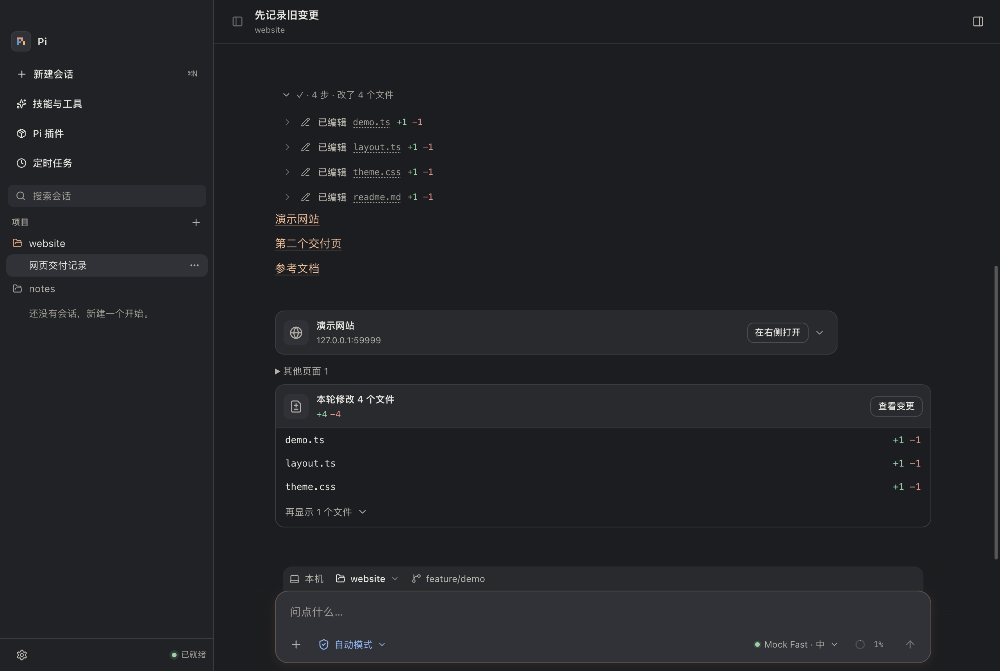
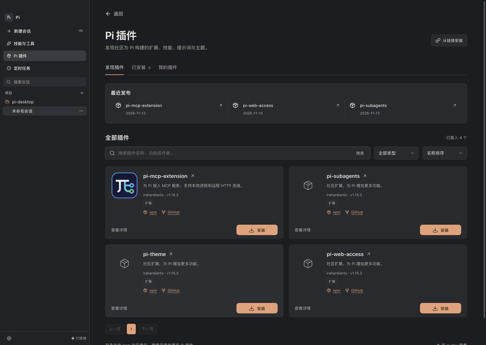
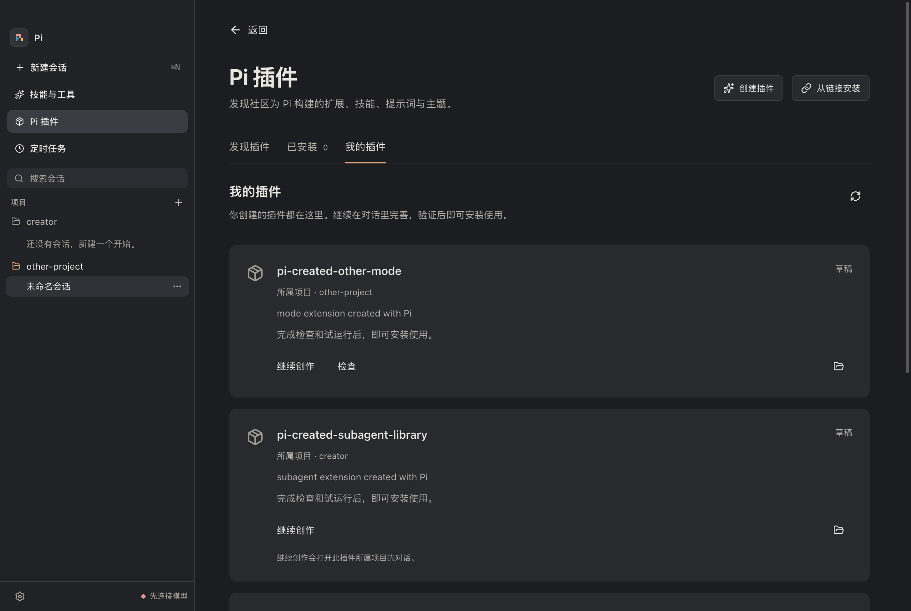

  

<h1 align="center">Pi Desktop</h1>

<strong>在对话里完成工作，也为你的 AI 创造新能力。</strong>

  <a href="https://github.com/SuperWBY/pi-desktop/releases">下载安装</a> ·
  <a href="#快速开始">快速开始</a> ·
  <a href="#你可以用它做什么">功能介绍</a> ·
  <a href="#把想法变成插件">创意模式</a> ·
  <a href="docs/development.md">开发指南</a>

Pi Desktop 是基于 [Pi](https://pi.dev) 的桌面 Agent 工作台。连接你使用的模型，用自然语言处理项目、文件和网页，在同一个窗口里查看执行过程、检查改动、预览结果。

你还可以安装社区插件，或者直接告诉 Pi 想增加什么功能，让它为自己创建插件。常用的能力可以留下来，继续修改、安装和复用。

界面截图使用隔离的示例数据，展示当前开发版。

## 你可以用它做什么

### 把任务交给 AI，在原处检查结果

让 Pi 阅读项目、修改代码、整理资料或生成网页。执行过程会显示读取、编辑和运行了什么；文件改动可以查看差异，图片、网页等结果可以直接预览。

项目、对话、文件和工作面板放在一起。你可以继续追问、调整要求，也可以切换到另一段对话，回来查看后台任务的状态。

### 用你自己的模型和工作方式

复用已有的 Pi 模型配置，或在设置中连接模型服务。切换模型、推理强度和会话权限，在输入区就能完成。

支持图片与文件附件、`@` 引用项目文件、`/` 调用技能和命令，以及执行中的补充指令。点击上下文圆环，可以查看用量、分类明细和压缩状态。

### 让 AI 使用网页和桌面工具

浏览器可以在工作面板中打开网页，供你查看，也可由 Pi 操作。支持应用内浏览器、专用 Chrome 和 Chrome 扩展桥等接入方式。

macOS 上还提供 Computer Use，可在授权后观察和操作桌面应用。文件、网络和敏感操作遵守当前会话的权限设置。

### 把重复的工作安排到以后

在对话里描述“5 分钟后提醒我”或“每天整理一次这个项目”，也可以从侧栏进入定时任务，设置执行时间、查看运行状态和历史结果。

任务支持一次性、周期和文件变化触发。执行条件与电脑运行状态有关，详见[常见问题](#常见问题)。

### 找到需要的插件，也管理自己的作品

**Pi 插件**提供三个入口：

| 入口 | 用途 |
| --- | --- |
| **发现插件** | 搜索社区插件，按类型筛选，阅读作者说明并直接安装。 |
| **已安装** | 查看已有插件，更新或卸载。 |
| **我的插件** | 汇总自己创建的草稿和插件，查看所属项目，继续创作、验证与安装。 |

插件详情优先展示作者提供的对应语言 README。没有时先显示原文；需要 AI 翻译时，由你主动选择，译文会明确标注来源。

## 把想法变成插件

输入 **`/create`**，进入创意模式，然后直接描述想实现的功能。

例如：

> 我希望 Pi 在开始修改文件前，先给出一份计划，并让我随时切回执行模式。

> 帮我做一个插件，把长工具输出整理成更适合后续对话使用的内容，保留原始记录。

> 我想把资料收集交给一个独立的 Agent，再把结果带回当前对话。

这些是起点。你也可以描述自己的想法，让 Pi 依据当前运行时支持的工具、命令和扩展接口创作。

创作始终在对话里进行。完成后，到 **Pi 插件 → 我的插件** 找到作品，检查、试运行，再安装使用；后续修改也能回到对应项目继续完成。进入创意模式不会替你更换聊天模型或提高文件权限。

## 快速开始

### 1. 安装 Pi Desktop

到 [GitHub Releases](https://github.com/SuperWBY/pi-desktop/releases) 下载适合设备的安装包。macOS Apple Silicon 用户可下载 `arm64.dmg`，打开后将 Pi Desktop 拖入 Applications。

**本 README 介绍当前开发分支。已发布安装包的功能以对应版本说明为准；体验尚未发布的功能，可以[从源码启动](docs/development.md#本地启动)。**

当前主要验证平台为 **macOS Apple Silicon**。仓库也提供 Windows 与 Linux 打包脚本，平台支持情况见[开发指南](docs/development.md#平台与打包)。

### 2. 连接模型

首次启动按引导连接模型。已经使用 Pi 的用户，可以复用本机的模型与登录配置；没有安装 Pi 时，macOS 发布构建可使用随应用提供的运行时。

Pi Desktop 不提供模型额度，模型调用费用取决于你连接的服务。

### 3. 开始一个任务

新建对话，直接输入需求。需要处理本地文件时，选择或添加项目目录，再说明想完成什么。

可以从一个具体任务开始：

- “读一下这个项目，说明它的结构和启动方式。”
- “把这份资料整理成一个可以预览的网页。”
- “检查这些文件的改动，列出需要我关注的问题。”
- “我想为 Pi 增加一个功能，进入创意模式一起做。”

## 让日常使用更顺手

- **看得清过程**：流式回复、工具调用、文件差异和最终结果可以按需展开查看。
- **长对话也能管理**：支持会话搜索、分支、导出、轮次导航和上下文压缩。
- **桌面体验**：深浅主题、中英文界面、键盘导航与轻量交互动效。
- **Mac 触摸板导航**：插件、技能、设置和定时任务支持双指轻扫返回与前进，普通滚动保持系统行为。
- **了解用量**：查看本地会话的 Token 用量、缓存和费用估算。

| 常用操作 | macOS 快捷键 |
| --- | --- |
| 新建对话 | `⌘N` |
| 打开项目 | `⌘O` |
| 收起或展开侧栏 | `⌘B` |
| 打开工作面板 | `⌘⇧E` |
| 打开应用内浏览器 | `⌘⇧B` |
| 打开设置 | `⌘,` |
| 发送 / 换行 | `Enter` / `Shift+Enter` |
| 停止当前执行 | `Esc` |

## 常见问题

**它和 Pi 是什么关系？**

[Pi](https://pi.dev) 提供 Agent 运行时、模型接入、工具和扩展机制；Pi Desktop 提供围绕这些能力的桌面界面，以及浏览器、定时任务、预览和本机集成。

**会话和配置保存在哪里？**

会话与模型配置由本机 Pi 管理，桌面偏好和任务记录保存在应用数据目录。模型请求会发送给你选择的服务；外部工具和连接器也会按其用途访问相应服务。

**关闭应用后，定时任务还会执行吗？**

默认需要应用运行。可以在设置中启用后台运行相关选项。电脑关机或睡眠期间不能保证准点执行；周期补跑和文件监听的边界见[定时任务说明](docs/development.md#定时任务的运行条件)。

**所有 Pi 扩展都能直接用于桌面吗？**

需要看扩展使用的接口。Pi Desktop 使用 RPC 模式，部分专为终端设计的自定义 UI 无法直接显示。创作插件时会检查实际加载情况，具体功能仍需在对话中验证。首版子 Agent 模板以独立只读任务为起点。

**macOS 安装时出现安全提示怎么办？**

先确认安装包来自本仓库的 Releases，并阅读该版本的签名说明。开发构建可能没有 Apple Developer ID 公证；本地构建与正式分发的区别见[签名说明](docs/development.md#macos-签名)。

## 参与这个项目

遇到问题或有新的使用场景，欢迎[提交 Issue](https://github.com/SuperWBY/pi-desktop/issues)。报告问题时，请说明系统、应用版本、复现步骤和预期结果，并注意移除日志中的凭据与私人内容。

准备修改代码，可从[开发指南](docs/development.md)开始；界面、交互、动画和验证约定见 [AGENTS.md](AGENTS.md)。

感谢 [Pi](https://pi.dev) 及本项目使用的开源组件。第三方分发声明见 [THIRD_PARTY_NOTICES.md](THIRD_PARTY_NOTICES.md)。
